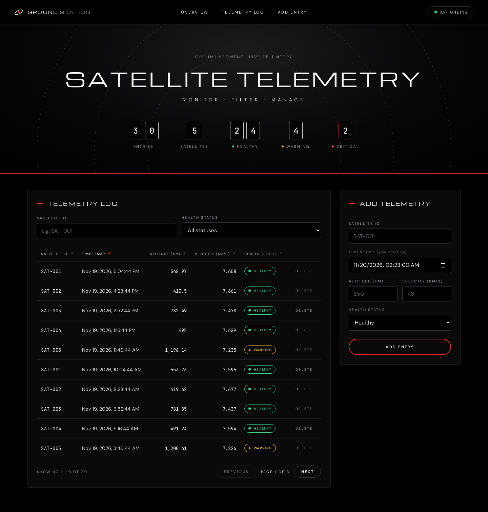
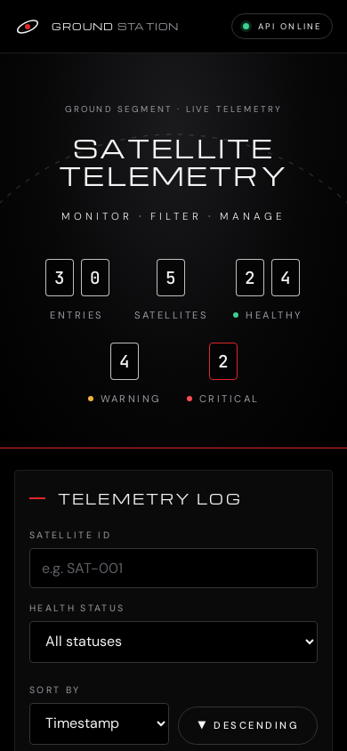

# Satellite Telemetry Dashboard

[](https://github.com/Anthonyhu1988/satellite-telemetry-dashboard/actions/workflows/ci.yml)

Repo: https://github.com/Anthonyhu1988/satellite-telemetry-dashboard (same link for the backend and frontend tasks)

A REST API and a React dashboard for viewing, filtering, adding and deleting satellite telemetry.
Both parts of the take-home live in this one repo:

- **Backend task** → [`backend/`](backend) (Node 24, Express 5, TypeScript, in-memory SQLite)
- **Frontend task** → [`frontend/`](frontend) (React 18, Vite, TypeScript)
- [`packages/shared/`](packages/shared) holds the telemetry types and validation schema both sides use



## Quick start (Docker)

The only thing you need installed is Docker.

```bash
docker compose up --build
```

| What               | URL                             |
| ------------------ | ------------------------------- |
| Dashboard          | http://localhost:8080           |
| API                | http://localhost:3000/telemetry |
| API docs (Swagger) | http://localhost:3000/docs      |

The API starts with 30 seeded readings from 5 satellites so there's something to look at. Data lives in
memory, so restarting the `api` container resets it.

If ports 3000 or 8080 are taken, copy `.env.example` to `.env` and change `API_PORT` / `WEB_PORT`.

Stop with `Ctrl+C`, clean up with `docker compose down`.

### Just the API container

```bash
docker build -f backend/Dockerfile -t telemetry-api .
docker run --rm -p 3000:3000 telemetry-api
```

(The build context is the repo root because the backend imports `packages/shared`.)

## Running without Docker

Needs Node 22+ (I used 24 LTS).

```bash
npm install
npm run dev
```

That starts the API on `:3000` and the Vite dev server on http://localhost:5173. Vite proxies `/api/*`
to the API the same way nginx does in Docker, so the frontend code doesn't care which one it's running
behind.

Each half also runs on its own:

```bash
npm run dev -w backend     # API only  (or: cd backend && npm run build && npm start)
npm run dev -w frontend    # dashboard only, expects the API on :3000
```

**Mock API mode.** The brief allows the frontend to run against a mock. To run the dashboard with no
backend at all:

```bash
VITE_USE_MOCK=true npm run dev -w frontend
```

This uses [MSW](https://mswjs.io/) to intercept `GET/POST/DELETE /telemetry` in the browser. The same
handlers are used by the frontend tests.

## Tests

```bash
npm test                  # shared + backend + frontend
npm run test:coverage     # same, with coverage thresholds enforced
npm run lint
npm run typecheck
```

Or with only Docker installed:

```bash
docker compose --profile test run --rm api-test
docker compose --profile test run --rm web-test
```

Current numbers: 175 tests. Backend is at 100% line coverage, frontend at 100% lines / ~97% branches.
CI (`.github/workflows/ci.yml`) runs lint, typecheck and tests on every push, then builds the Docker
stack and smoke-tests it through nginx.

What's covered:

- **shared**: every validation rule (bad/date-only/zone-less/impossible timestamps, zero/negative/NaN/string
  numbers, unknown status, unknown fields)
- **backend**: each layer on its own (SQL gateway, service with a fake gateway, middleware) plus full
  HTTP tests with Supertest for every endpoint, including 400/404 paths and pagination edge cases
- **frontend**: API client error handling, the reducer, the data hook, each component, and full app
  flows (filter, sort, page, add, delete, backend down → retry) against the MSW mock API

## API

All responses are JSON. Errors always look like:

```json
{
  "error": {
    "code": "VALIDATION_ERROR",
    "message": "Request validation failed",
    "details": [{ "field": "altitude", "message": "altitude must be a positive number" }]
  }
}
```

| Method   | Path                 | Notes                                                             |
| -------- | -------------------- | ----------------------------------------------------------------- |
| `GET`    | `/telemetry`         | `satelliteId`, `status`, `page`, `limit`, `sortBy`, `order`       |
| `POST`   | `/telemetry`         | 201 with the created entry, 400 with field errors                 |
| `GET`    | `/telemetry/:id`     | 200, 404 if missing, 400 if the id isn't a UUID                   |
| `DELETE` | `/telemetry/:id`     | 204, 404 if missing                                               |
| `GET`    | `/telemetry/summary` | counts per status + list of satellite IDs (used by the dashboard) |
| `GET`    | `/health`            | used by the Docker healthcheck                                    |

`GET /telemetry` returns `{ data, pagination: { page, limit, total, totalPages } }`.

```bash
# everything
curl localhost:3000/telemetry

# filter + paginate + sort
curl "localhost:3000/telemetry?satelliteId=SAT-002&status=healthy&page=1&limit=5&sortBy=altitude&order=asc"

# add one
curl -X POST localhost:3000/telemetry -H 'Content-Type: application/json' \
  -d '{"satelliteId":"SAT-009","timestamp":"2026-11-19T08:00:00Z","altitude":550,"velocity":7.6,"status":"healthy"}'

# validation error -> 400
curl -X POST localhost:3000/telemetry -H 'Content-Type: application/json' \
  -d '{"satelliteId":"SAT-009","timestamp":"tomorrow","altitude":-5,"velocity":7.6,"status":"healthy"}'

# get / delete by id
curl localhost:3000/telemetry/<id>
curl -X DELETE localhost:3000/telemetry/<id>
```

## How it's put together

### Backend

```
routes/        URL -> controller, runs validation middleware
controllers/   HTTP only: read validated input, call the service, pick the status code
services/      business rules: ids, UTC timestamps, paging math, NotFound
gateways/      TelemetryGateway interface (what the service needs from storage)
db/            SQLite connection, the gateway implementation, seed data
middleware/    validate (zod) + one error handler for every error shape
app.ts         wires everything together; tests build a fresh app per test
```

The service only depends on the `TelemetryGateway` interface, never on SQLite. Swapping in Postgres
would mean writing one new gateway class and changing one line in `app.ts`. The gateway methods are
async for that reason, even though better-sqlite3 is synchronous.

### Frontend

- `api/telemetryClient.ts`: small fetch wrapper that turns failures into either a `NetworkError`
  (backend unreachable, including a 502 from nginx) or an `ApiError` with per-field messages
- `hooks/telemetryReducer.ts` + `useTelemetry.ts`: all list state (items, filters, sort, page, loading,
  error) lives in one `useReducer`, and an effect refetches whenever the query changes
- `components/`: table, filters, form, pagination, confirm dialog, toast, spinner, error banner and summary cards
- Styling is plain CSS in `styles.css`, themed after Rocket Lab's own site: black background, a wide
  display face (Michroma) for headings, letter-spaced uppercase labels, red as the single accent, and
  digit-tile counters. Status still uses colour plus shape plus text so it reads without colour.

Filtering, sorting and paging all happen on the server, so they stay correct once there are more
rows than fit on one page.

## Decisions and assumptions

- **Storage.** The brief asks for an in-memory database. I went with SQLite in `:memory:` mode over a
  plain array so filtering, sorting and pagination are real SQL instead of hand-written loops. It's
  still in-process and resets on restart, so there's no separate DB container.
- **Status values.** The brief gives "healthy" and "critical" as examples. I added `warning` and made
  it a fixed list (`healthy | warning | critical`). Input is case-insensitive and stored lowercase.
- **Timestamps** must be full ISO 8601 with a timezone (`Z` or `+02:00`). Date-only or zone-less values
  are rejected because they're ambiguous. They're stored in UTC so sorting by time works across offsets.
- **Positive numbers** means `> 0`. Numbers sent as strings (`"550"`) are rejected rather than coerced.
- **Units** are assumed to be km for altitude and km/s for velocity (they're only labels, nothing converts).
- **"Retrieve all" vs pagination.** `GET /telemetry` with no `page`/`limit` returns everything, as the
  brief says. Pass either one to paginate (default page size 20, max 100). The dashboard always pages (10 per page).
- **`satelliteId` filter** is an exact match. The dashboard offers known IDs as suggestions so you don't
  have to remember them.
- **Validation runs twice**, in the form and in the API, using the same zod schema from `packages/shared`,
  so the two can't drift apart.
- **No auth.** It's out of scope for the brief, and CORS is open so the API can be called from anywhere locally.

## Requirements checklist

| Brief                                                                                | Where                                                                |
| ------------------------------------------------------------------------------------ | -------------------------------------------------------------------- |
| GET/POST `/telemetry`, GET/DELETE `/telemetry/:id`, `satelliteId` + `status` filters | `backend/src/routes`, tests in `backend/tests/telemetry.api.test.ts` |
| In-memory storage, persists during runtime                                           | `backend/src/db/connection.ts`                                       |
| ISO 8601 timestamp, positive altitude/velocity                                       | `packages/shared/src/telemetry.ts`                                   |
| Bonus: pagination                                                                    | `page` / `limit` on `GET /telemetry`                                 |
| Bonus: API unit tests                                                                | `backend/tests/`                                                     |
| Bonus: Docker                                                                        | `backend/Dockerfile`, `frontend/Dockerfile`, `docker-compose.yml`    |
| Table with the 5 columns, filters, add form, delete                                  | `frontend/src/components`                                            |
| Mock API or backend integration                                                      | both: real API by default, MSW mock with `VITE_USE_MOCK=true`        |
| React + state management                                                             | `useReducer` in `frontend/src/hooks`                                 |
| Validate form before sending                                                         | `TelemetryForm.tsx` (shared schema)                                  |
| Responsive                                                                           | table turns into cards under 640px, see below                        |
| Bonus: sorting                                                                       | click any column header (or the sort control on mobile)              |
| Bonus: API error handling                                                            | error banner + Retry, field errors from 400s, toast on failed delete |
| Bonus: component tests                                                               | `frontend/src/**/*.test.tsx`                                         |
| Bonus: loading spinner                                                               | first load and "Refreshing" indicator in the header                  |



## Trying the error handling

With the stack running:

```bash
docker compose stop api    # dashboard shows "Can't reach the telemetry API" with a Retry button
docker compose start api   # hit Retry, data comes back
```

## What I'd do with more time

- Swap SQLite for a Postgres gateway (and a DB container) so data survives restarts
- Live updates over WebSockets/SSE instead of reloading after each change
- Per-satellite charts of altitude/velocity over time
- Date-range filtering and editing existing entries (PUT/PATCH)
- Auth and rate limiting before this went anywhere near a real network
- Playwright end-to-end tests against the Docker stack
